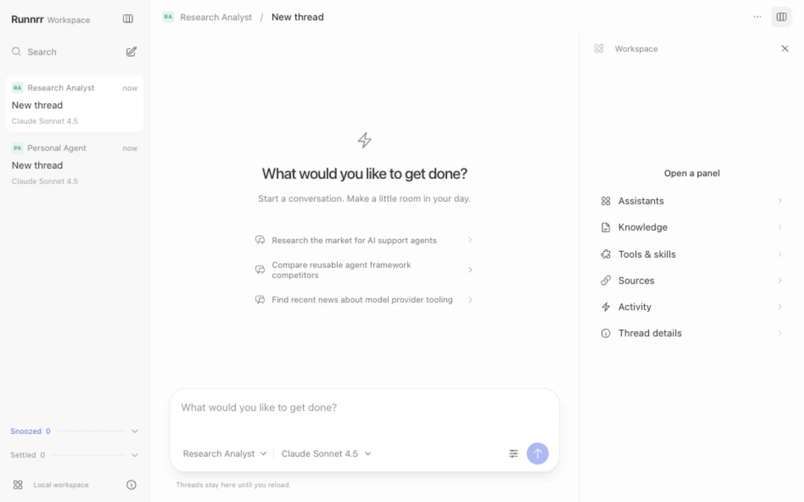

# Runnrr

A self-hosted control surface for agents doing work beyond coding: customer
support, research, and other business workflows.
Runnrr is a portfolio demo built to show employers how agent workflows can feel
like a complete product. It brings threads, project context, tool activity, and
usage into one workstation.
The current runtime calls provider APIs; installed CLI agents and subscription
harnesses are a future integration.
Choose an agent, give it a task, and follow its response and tool activity in one place.



*The local Runnrr workstation. The separate [EasyAgent showcase](https://bryanzane.com/easyagent/) retains its older interface.*

Regenerate: `npm ci && npx playwright install chromium && npm run capture`
(Node.js and `cwebp` required; start the local runtime first).

Runnrr currently supports live streaming chat, configured agent profiles,
read-only knowledge tools, skills, web research, and usage accounting. The web
workstation is served by the runtime itself. Threads, drafts, organization, and
completed conversation context are saved in a small SQLite database.

## Quick start

Run from the downloaded or cloned repository folder: the Python wheel alone does not include the web
workstation or bundled profiles.

Python 3.13 is pinned in
`.python-version` (supported range: 3.11–3.13).

```bash
uv sync --frozen --extra dev --extra rag
cp .env.example .env
```

Add a provider key to `.env` and choose its model with `DEFAULT_MODEL`.
Configure `DEMO_REQUEST_COST_BOUNDS` with reviewed maximum costs per provider
attempt (in microdollars, including full input/output limits). Its empty default
intentionally blocks paid requests. The runtime reserves those bounds against
a $0.50 daily allocation; do not substitute estimated average prices.
Use `DEFAULT_PROFILE=customer-service` for a bundled, self-contained KB.
Supported provider keys include `ANTHROPIC_API_KEY`, `OPENAI_API_KEY`,
`DEEPSEEK_API_KEY`, `MOONSHOT_API_KEY`, and `GEMINI_API_KEY`.
Keys stay on the server. `TAVILY_API_KEY` enables web search.

```bash
.venv/bin/python -m uvicorn runnrr.app:app --host 127.0.0.1 --port 8001
```

Open **http://127.0.0.1:8001**. No frontend build or separate web server is required.
After frontend edits, reload the page. Add `--reload` for backend development.

## Workstation

- **Threads:** compact sidebar with search, rename, pins, snooze, settle,
  restore, and deletion with immediate undo. Snooze moves a thread into its own
  section until the chosen time, then returns it to the main list—even after
  reopening the app. It never schedules agent work. Settled threads stay settled
  until restored.
- **Conversation:** streaming Markdown, expandable tool activity, source labels,
  copy response, and token usage, with a floating multiline composer.
- **Assistant and model selectors:** use the real profiles and available models.
  Changing either for an existing conversation starts a separate thread.
  Set `DEFAULT_PROFILE` in `.env` to choose the initial agent.
- **Workspace panel:** browse assistants, configured knowledge, tools and skills,
  sources, activity, and thread details. Resize it by dragging its divider or
  using the arrow keys on the focused divider. Side panels become drawers on mobile.

**Customer service demo:** open Workspace → Customer service demo to send the
agent through three simulated customer conversations. The small monitoring panel
shows real model replies and tool activity, with links to the saved threads.
Keep the page open during a run; Stop run cancels the current request. No reply
is sent to a real inbox. Runs use your configured provider and budget.

**Project knowledge:** choose Dark Souls knowledge for the bundled local wiki
collection. The assistant uses existing retrieval tools and cites its sources.
Hybrid semantic retrieval needs an index built first; keyword search and file
reading work without it. Optional web search supplements missing local evidence.
See [knowledge setup](docs/guide.md#knowledge-and-evaluations).

The Tools panel lets users turn configured abilities on or off for the next message.
Preferences stay in this browser and apply across assistants. Built-in and custom
tools are separated, with explanations of search quality, time, and cost tradeoffs.
Unavailable tools cannot be enabled; past tool results remain in conversation history.
Custom integrations still require developer setup.

Agent creation, attachments, file generation/previews,
voice, approvals, messaging, scheduled work, and account authentication
are not implemented in the workstation yet. No actions are simulated
as successful. The original supplied design is preserved in [docs/design/](docs/design/).

The former dashboard, builder, and eval pages have been removed. Their backend
APIs and eval CLI remain available. The builder write API is still disabled
by default (`ENABLE_PROFILE_EDITOR=0`).

## Usage analytics

Open **Workspace → Usage & costs** for persistent chat metrics by day, model,
provider and assistant. Expand a response’s usage line for token/cache/reasoning
breakdowns, estimated cost, timing and context usage. Reasoning is included in
output and counted once. Unknown pricing and partial reports are labeled.
Usage stores accounting metadata separately from saved conversations. See
[usage accounting and API details](docs/usage.md).

## Validation

```bash
scripts/check.sh
npm ci
npx playwright install chromium
scripts/check-browser.sh
npm run format:check
```

Python tests and Node assertions use fake providers. Browser checks start an
isolated local runtime with temporary databases and block real chat requests.
They cover thread actions, model binding, streaming isolation, safe Markdown,
project import, usage, and responsive controls. Current visual verification is
recorded in [design QA](docs/design/qa.md).

## Architecture and privacy

FastAPI exposes `/api/chat` as SSE and read-only profile, model, health,
budget, tool, retrieval, and evaluation endpoints. Anthropic, OpenAI-compatible,
and Gemini adapters share one agent loop. An in-memory session cache coordinates active requests, so run a single worker.
Workspace threads and provider context persist in `data/sessions.sqlite3`
(`RUNNRR_SESSION_DB`); budgets, usage, and projects use separate SQLite files.
Interrupted responses are marked incomplete and never resumed automatically.
Legacy chat clients without a workspace header remain temporary.

A random browser workspace key controls access to saved threads and projects.
Clearing that key loses access; this is not account authentication or recovery.
Back up the runtime data and protect it as conversation content.

Only `web/` is served as public static content. `.env`, profiles, local KBs,
and Git metadata are not web assets. Private knowledge, resumes, codebase
dumps, and credentials stay ignored. `kb/frampton/` is the exception: it
contains public third-party wiki material.

The scope is a polished employer showcase, with simulated support work and
real agent responses. Production inbox integrations, account systems, and
autonomous scheduling are outside the current delivery scope. See
[the roadmap](docs/roadmap/README.md).

## Documentation

- [Maintenance results and remaining work](docs/maintenance.md)
- [Saved threads and support demonstration](docs/sessions.md)
- [Project storage and refresh](docs/projects.md)
- [Usage accounting](docs/usage.md)
- [Bundled agents](docs/guide.md#bundled-agents)
- [Add an agent](docs/guide.md#add-an-agent)
- [Knowledge and evaluations](docs/guide.md#knowledge-and-evaluations)

## Contributing and deployment

See [CONTRIBUTING.md](CONTRIBUTING.md), [AGENTS.md](AGENTS.md), and
[history.md](history.md). Deployment remains manual; see [deploy/README.md](deploy/README.md).
The separate frozen public-site deployment is not changed by this repository.

## License

[MIT](LICENSE). Vendored frontend assets retain their [upstream licenses](web/vendor/README.md).

### Project workspaces

New thread → choose assistant → choose a project or No project. Use the folder
icons to search and import your own text folders. The hosted demo instead lists
Bryan’s public portfolio. See [project storage and refresh](docs/projects.md).

## Repository layout

| Work on | Start here |
| --- | --- |
| HTTP endpoints and streaming lifecycle | [runnrr/app.py](runnrr/app.py) |
| Agent loop and tool-call ordering | [runnrr/agent.py](runnrr/agent.py) |
| Models and provider adapters | [runnrr/config.py](runnrr/config.py), [runnrr/providers/](runnrr/providers/) |
| Saved threads and conversation context | [runnrr/sessions.py](runnrr/sessions.py), [web/js/thread-store.mjs](web/js/thread-store.mjs) |
| Projects and workspace ownership | [runnrr/projects.py](runnrr/projects.py), [web/js/projects.mjs](web/js/projects.mjs) |
| Tool registration and permission checks | [runnrr/tools/registry.py](runnrr/tools/registry.py), [runnrr/tools/dispatch.py](runnrr/tools/dispatch.py) |
| Knowledge retrieval and indexing | [runnrr/rag/](runnrr/rag/), [runnrr/kb_loader.py](runnrr/kb_loader.py) |
| Tokens, costs, and spending limits | [runnrr/usage.py](runnrr/usage.py), [runnrr/metrics.py](runnrr/metrics.py), [runnrr/budget.py](runnrr/budget.py), [runnrr/pricing.py](runnrr/pricing.py) |
| Workstation layout and styling | [web/index.html](web/index.html), [web/css/](web/css/) |
| UI wiring and chat rendering | [web/js/app.mjs](web/js/app.mjs), [web/js/chat.mjs](web/js/chat.mjs), [web/js/transcript.mjs](web/js/transcript.mjs) |
| Thread organization and support demo | [web/js/threads.mjs](web/js/threads.mjs), [web/js/support-demo.mjs](web/js/support-demo.mjs) |
| Tool preferences | [web/js/tool-settings.mjs](web/js/tool-settings.mjs) |
| Agent personas and allowed tools | [profiles/](profiles/), [runnrr/profiles.py](runnrr/profiles.py) |
| Evaluation CLI and grading | [runnrr/evals/](runnrr/evals/) |
| Setup, current scope, and release steps | [docs/guide.md](docs/guide.md), [docs/roadmap/](docs/roadmap/README.md), [deploy/](deploy/README.md) |

Tests are grouped into `tests/api/`, `tests/runtime/`, `tests/providers/`,
`tests/tools/`, `tests/rag/`, and `tests/evals/`. Shared fixtures stay in
`tests/conftest.py` and `tests/fixtures/`. Run a subsystem with, for example,
`.venv/bin/python -m pytest tests/rag/ -q`.
`tests/unit/` contains browser-independent Node assertions;
`tests/browser/` contains the browser runner and interaction checks.
The full checks remain `scripts/check.sh` and `scripts/check-browser.sh`.

Only `web/` is public: scripts live in `web/js/`, styles in `web/css/`, and
third-party assets and licenses in `web/vendor/`. There is no frontend build.
Design exports in `docs/design/source/` and plans in `docs/plans/archive/`
are historical reference material, not shipped application code.
